<div align="center">

# nutribuddy — Cited Diet Plans For Chronic Conditions

**nutribuddy is a retrieval-grounded diet planner for people with diabetes, heart disease or a thyroid disorder. It takes symptoms or a selected condition through these steps to a cited diet plan with real food examples:**

`register sources` → `chunk and index` → `screen symptoms` → `retrieve diet passages` → `validate the JSON plan` → `add foods from the food store` → `answer follow-up questions`.


**[Summary](#1-summary)** ·
**[Workflow](#4-the-end-to-end-workflow)** ·
**[Run it](#10-how-to-run-nutribuddy)** ·
**[Configuration](#104-environment-variables)** ·
**[Known problems](#13-known-problems)** ·
**[Glossary](#15-glossary)**

</div>

> [!NOTE]
> This README uses ASD-STE100 Simplified Technical English. The writing rules and the project
> vocabulary are in [`docs/ste-style-guide.md`](docs/ste-style-guide.md). Each term in the
> [Glossary](#15-glossary) has only one meaning.

> [!WARNING]
> Do not use nutribuddy to diagnose or treat a person. nutribuddy gives general nutrition information from its
> sources. A clinician or a registered dietitian must review every diet change.

---

nutribuddy gives a cited diet plan for one of three chronic conditions. Each claim in a plan points to a page
of a registered source. Each food example comes from a food composition table with its amount per 100 g. The
main idea is a strict split: the chat model only reads passages and fills a JSON schema. Deterministic code
does the search, the nutrient lookup, the safety checks and the output.

This README is the **one location that explains all of nutribuddy**. It gives these topics:

- the general design
- each component and its procedure, step by step
- the decision rules
- the data map
- the runbook
- the validation results and the known problems

| If you are… | Read |
|---|---|
| A manager or reviewer | [1](#1-summary), [3](#3-design-rules), [4](#4-the-end-to-end-workflow), [12](#12-validation-results), [14](#14-key-points) |
| A developer who joins the project | All sections, in sequence. Keep [10](#10-how-to-run-nutribuddy) and [13](#13-known-problems) open while you work |
| An operator who runs nutribuddy | [10](#10-how-to-run-nutribuddy), then the section for the component that you use |

---

## Table of contents

1. 🧭 [Summary](#1-summary)
2. 🏗️ [How nutribuddy is built](#2-how-nutribuddy-is-built)
   - 2.1 [Components](#21-components)
   - 2.2 [System context](#22-system-context)
   - 2.3 [Repository layout](#23-repository-layout)
3. 🛡️ [Design rules](#3-design-rules)
4. 🔄 [The end-to-end workflow](#4-the-end-to-end-workflow)
   - 4.1 [Full flow](#41-full-flow)
   - 4.2 [The life cycle of one request](#42-the-life-cycle-of-one-request)
   - 4.3 [Who does which step](#43-who-does-which-step)
5. 🔵 [Ingestion and the index](#5-ingestion-and-the-index)
6. 🟢 [Symptom screening](#6-symptom-screening)
7. 🟣 [The diet plan and follow-up questions](#7-the-diet-plan-and-follow-up-questions)
8. ⚖️ [The safety model and the decision rules](#8-the-safety-model-and-the-decision-rules)
9. 🗂️ [Data and file map](#9-data-and-file-map)
10. ▶️ [How to run nutribuddy](#10-how-to-run-nutribuddy)
    - 10.1 [Prerequisites](#101-prerequisites) · 10.2 [Installation](#102-installation) · 10.3 [Run nutribuddy](#103-run-nutribuddy) · 10.4 [Environment variables](#104-environment-variables)
11. 🧩 [How to extend nutribuddy](#11-how-to-extend-nutribuddy)
12. ✅ [Validation results](#12-validation-results)
13. ⚠️ [Known problems](#13-known-problems)
14. 📌 [Key points](#14-key-points)
15. 📖 [Glossary](#15-glossary)
16. 📄 [License](#16-license)

---

## 1. Summary

**The problem.** A person with a chronic condition wants diet guidance that is specific, sourced and safe. These are the difficult questions:

- Which condition do the sources connect to a set of symptoms, without a false diagnosis?
- Which nutrients and foods do trusted sources give for that condition?
- Which real foods contain those nutrients, and how much?
- How do you keep the answer honest when the chat model makes an error?

nutribuddy gives each of these questions its own component. A chat model is optional: the offline model runs the full flow with no key and no network.

| Item | Value |
|---|---|
| Input | A symptom text, a selected condition or a follow-up question |
| Output | A screening status, a cited diet plan with food examples, or a cited answer |
| Components | **7**: registry and loader, chunker, index, food store, screening, planner, session store |
| Providers | Chat model: offline or any OpenAI-compatible endpoint (Ollama, vLLM, OpenAI). Embedder: hashing or sentence-transformers |
| Offline mode | All commands. The offline model and the hashing embedder need no download |
| Safety | Red flags go to urgent care. SQL uses bound parameters only. All model text is plain text |
| Tests | **73** unit tests (`pytest`). In CI, 72 pass and 1 skips because the `api` extra is not installed |

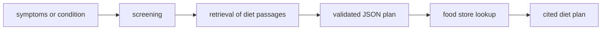

---

## 2. How nutribuddy is built

### 2.1 Components

| Component | Module | Purpose |
|---|---|---|
| Configuration | `src/nutribuddy/config.py` | Read and check all `NUTRIBUDDY_*` environment variables |
| Registry and loader | `src/nutribuddy/documents.py` | Validate `sources.json`, read pages from `.md`, `.txt` and `.pdf` |
| Chunker | `src/nutribuddy/chunker.py` | Split sections into chunks with overlap, keep page and section |
| Embedders | `src/nutribuddy/embeddings.py` | Hashing embedder (offline) and sentence-transformers embedder (extra) |
| Index | `src/nutribuddy/index.py` | BM25, dense search, reciprocal-rank fusion, reranker, manifest check |
| Food store | `src/nutribuddy/fooddb.py` | Idempotent FoodData Central load, nutrient resolution, food lookup |
| Chat models | `src/nutribuddy/llm.py` | Offline model, OpenAI-compatible adapter, scripted model for tests |
| Prompts | `src/nutribuddy/prompts.py` | System prompts and numbered passages |
| Structured output | `src/nutribuddy/schemas.py` | JSON extraction, pydantic schemas, retries with error feedback |
| Labels | `src/nutribuddy/conditions.py` | The three conditions and the tolerant label parser |
| Safety | `src/nutribuddy/safety.py` | Input cleanup, red flags, scope check |
| Screening | `src/nutribuddy/screening.py` | Symptom screening, keyword baseline, majority baseline |
| Planner | `src/nutribuddy/planner.py` | Diet plan with valid markers and food examples |
| Session store | `src/nutribuddy/sessions.py` | Server-side conversation history in SQLite |
| Service | `src/nutribuddy/service.py` | Builds all parts once, runs screening, plans and follow-up answers |
| Output | `src/nutribuddy/render.py` | Plain text plan and escaped HTML |
| Evaluation | `src/nutribuddy/evaluation.py` | Recall@k, MRR, accuracy with a 95% interval, macro-F1, plan and safety checks |
| Synthetic data | `src/nutribuddy/synthetic.py` | Demo sources, food table and evaluation sets |
| CLI | `src/nutribuddy/cli.py` | The `nutribuddy` command |
| API | `src/nutribuddy/api.py` | Optional FastAPI app and a small web page |

The component map shows which module calls which module. An arrow points from the caller to the module that it uses.

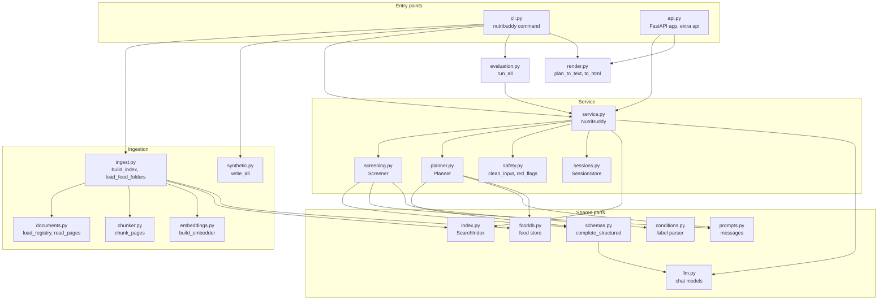

### 2.2 System context

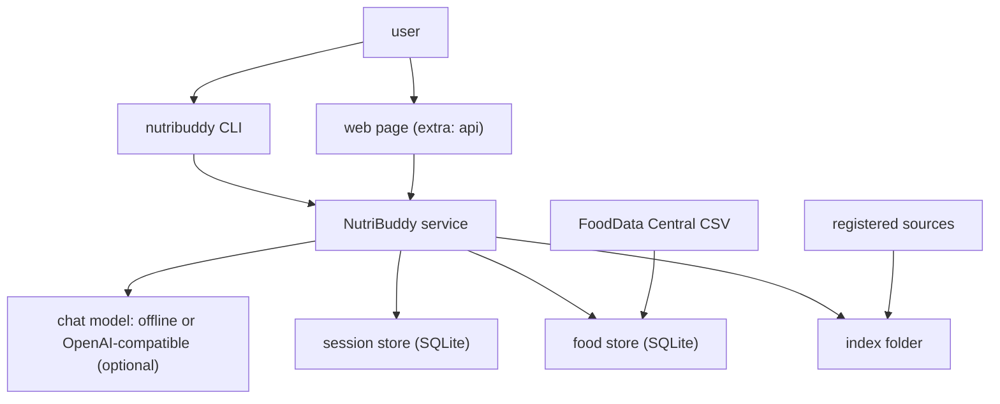

### 2.3 Repository layout

```
nutribuddy/
├── .github/workflows/ci.yml   # CI: install ".[dev]" and run pytest on Python 3.11
├── data/README.md             # data sources, licences, layout and download steps
├── docs/ste-style-guide.md    # writing rules and project vocabulary
├── src/nutribuddy/            # the package (one module for each component, see 2.1)
├── tests/                     # pytest suite: 73 tests, synthetic data only
├── .env.example               # variable names only
├── pyproject.toml             # core dependencies, extras and the console script
└── LICENSE                    # MIT
```

---

## 3. Design rules

### 3.1 Each claim has a source
The planner gives the chat model numbered passages and keeps only markers that point to a passage. `planner.valid_markers` removes other markers. Each plan and each answer ends with a source list that shows the title, the page, the section and the URL.

### 3.2 The chat model never writes SQL
The chat model gives nutrient names only. `fooddb.resolve_nutrient` maps each name to one row of the `nutrient` table with bound parameters and escaped `LIKE` wildcards. Names that do not resolve go to the warnings of the plan.

### 3.3 Model text is plain text
nutribuddy does not ask the chat model for HTML. `render.to_html` escapes all text, and the web page sets text with `textContent`. A tag in a reply or in user text shows as text.

### 3.4 No diagnosis from the screening step
The screening status names a possible condition to discuss with a clinician. Red flags go to urgent care before any search. The label parser accepts extra words and any letter case, but it refuses a reply that names two conditions.

### 3.5 Structured output with bounded retries
`schemas.complete_structured` extracts the first JSON object, validates it with pydantic and retries with the error, up to `NUTRIBUDDY_LLM_MAX_ATTEMPTS`. A refusal stops the retries. Each failure goes to the log, not to a silent `except`.

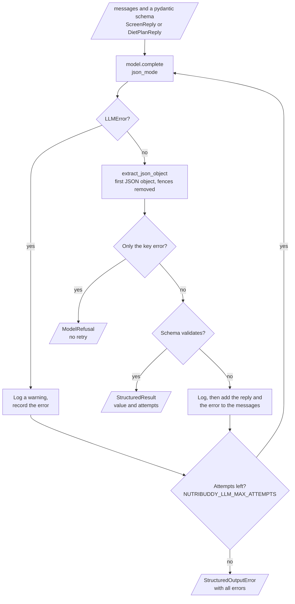

### 3.6 Expensive objects are built once
`NutriBuddy.from_settings` builds the embedder, the index, the chat model and the stores one time. A request writes no file in the working folder. The session store keeps the history on the server.

### 3.7 Light core, heavy extras
The core needs `numpy`, `pydantic` and `httpx`. PDF reading, sentence-transformers and FastAPI are extras. The default embedder and the offline model need no download.

---

## 4. The end-to-end workflow

### 4.1 Full flow

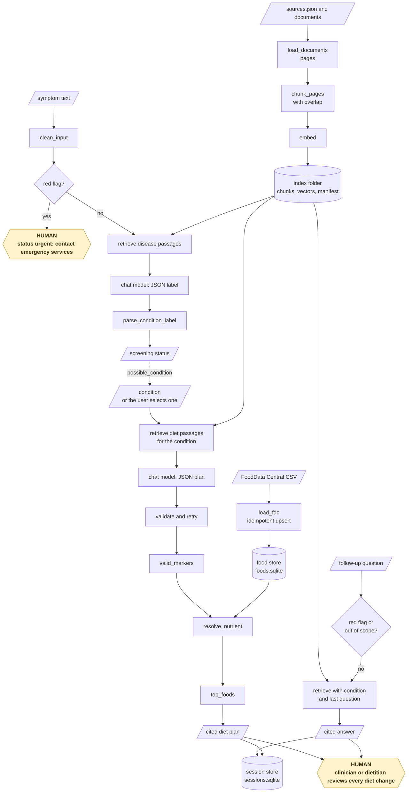

### 4.2 The life cycle of one request

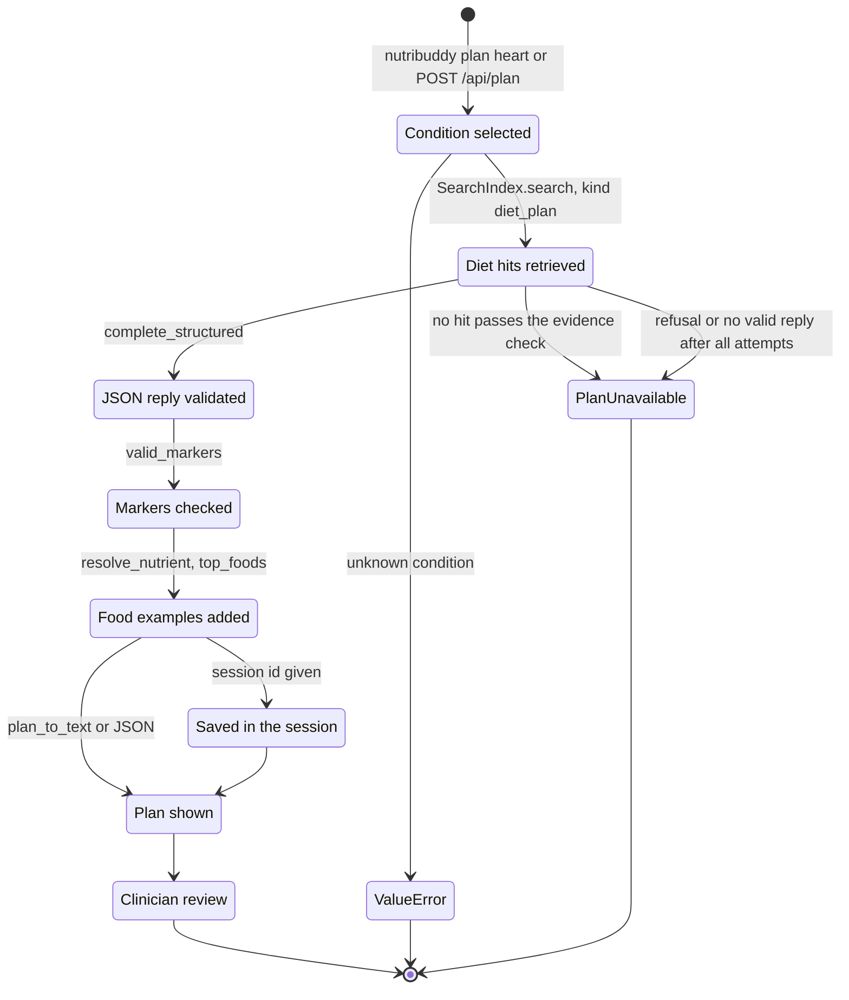

1. The user selects the condition `heart` on the web page or with `nutribuddy plan heart`.
2. The service makes the query "diet for Heart disease: foods and nutrients to include, foods to limit or avoid".
3. The index returns the `diet_plan` hits for `heart` that pass the evidence check.
4. The reranker orders the hits. The planner keeps the first `NUTRIBUDDY_TOP_K` hits as numbered passages.
5. The chat model returns a JSON reply. Pydantic validates it. If it fails, the planner sends the error and tries again.
6. The planner removes markers that point to no passage.
7. The food store resolves each nutrient name and returns the foods with the highest amount per 100 g.
8. The planner removes foods that match the foods to avoid or the `NEVER_SUGGEST` list.
9. The output shows the summary, the food examples, the foods to avoid, the sources and the disclaimer.

### 4.3 Who does which step

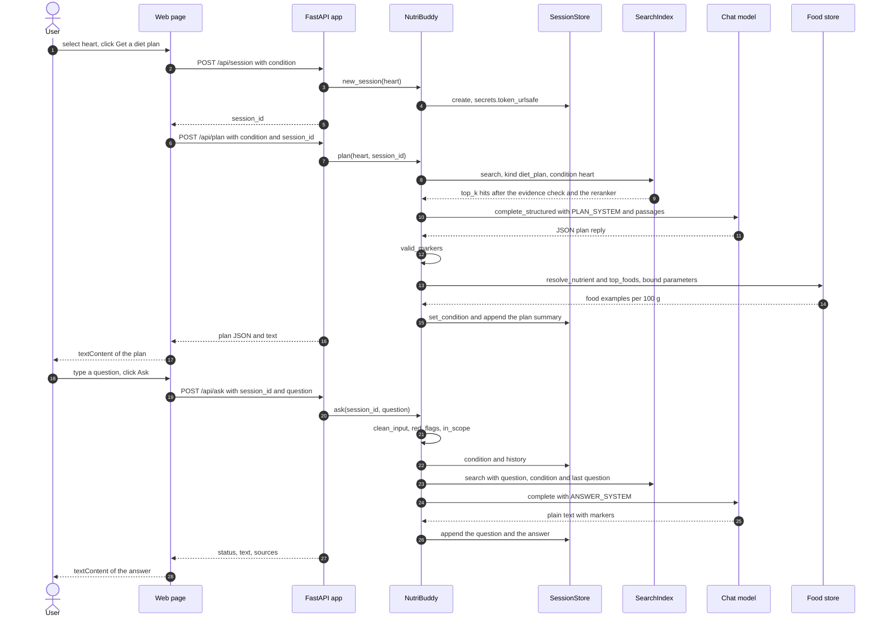

---

## 5. Ingestion and the index

**Purpose.** Make every registered source searchable, with a citation for each chunk.

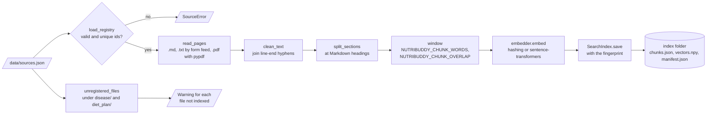

| Input | Output |
|---|---|
| `data/sources.json` and the files that it lists | `.nutribuddy/index/` with `chunks.json`, `vectors.npy` and `manifest.json` |
| FoodData Central CSV files | `.nutribuddy/foods.sqlite` |

**Procedure**

1. Validate `sources.json`: unique ids, a relative path, a known condition and kind, a URL and a licence.
2. Read each source page by page. A PDF needs the `pdf` extra. A form feed separates pages in a text file.
3. Join words that a line-end hyphen splits. Split each page at Markdown headings into sections.
4. Split each section into windows of `NUTRIBUDDY_CHUNK_WORDS` words with `NUTRIBUDDY_CHUNK_OVERLAP` words of overlap.
5. Embed all chunks. Save the chunks, the vectors and the manifest with the fingerprint.
6. Warn about files under `disease/` or `diet_plan/` that have no registry entry.
7. Upsert `nutrient.csv`, `food.csv` and `food_nutrient.csv`. Skip and count rows with bad numbers or unknown keys.

**Rules**

- The default chunk has 180 words. That is less than the 384-token limit of small sentence-transformers models, so no text is cut off.
- The index load fails if the embedder name, the index format or the fingerprint is different. Build the index again.
- A load of the same CSV files two times gives the same row counts.

The diagram shows how `load_fdc` fills the food store from one release folder.

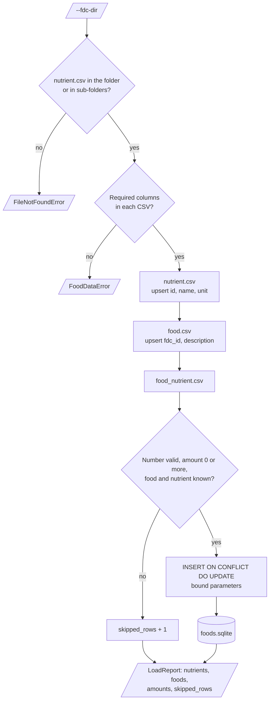

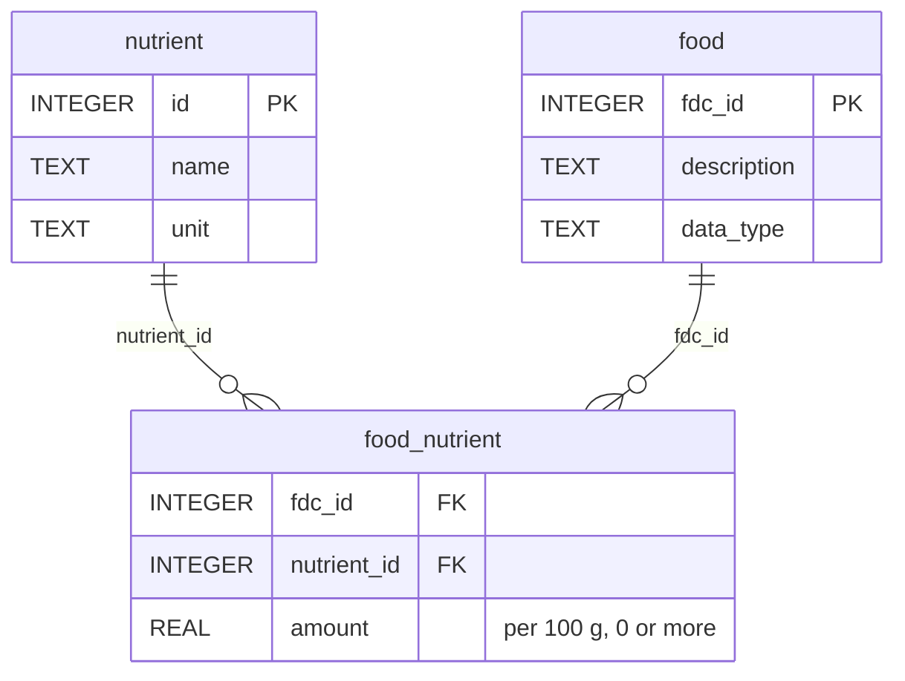

The diagram shows the stages of `SearchIndex.search`.

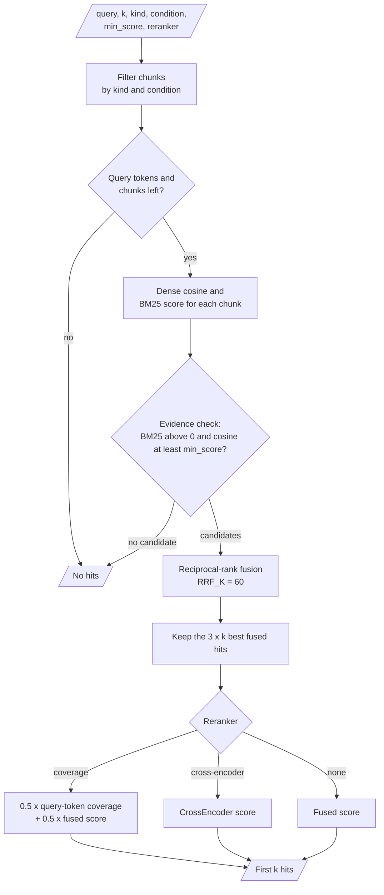

| Search stage | What it does |
|---|---|
| Filter | Keep chunks of the requested kind and condition |
| Evidence check | Keep chunks that share a token with the query and have a cosine similarity of at least `NUTRIBUDDY_MIN_SCORE` |
| Fusion | Reciprocal-rank fusion (k = 60) of the dense rank and the BM25 rank |
| Rerank | `coverage`: 0.5 × share of query tokens in the chunk + 0.5 × fused score. `cross-encoder` needs the `embeddings` extra |

---

## 6. Symptom screening

**Purpose.** Tell which supported condition the sources connect to a symptom text, or tell the user to get urgent care.

| Input | Output |
|---|---|
| A symptom text (max `NUTRIBUDDY_MAX_INPUT_CHARS` characters) | A status, a condition or none, a message and the cited `disease` passages |

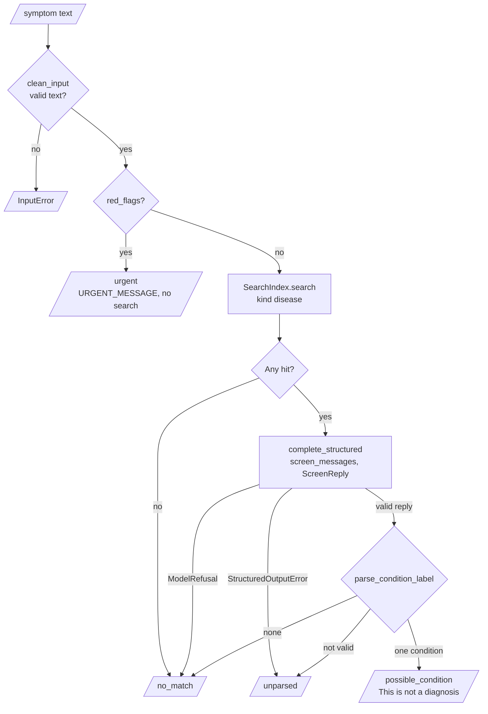

**Procedure**

1. Clean the text: normalize Unicode, remove control characters and check the length.
2. If the text has a red flag, return the status `urgent`. Do not search.
3. Retrieve `disease` hits. If no hit passes the evidence check, return `no_match`.
4. Send the numbered passages to the chat model. It must return `{"condition": ..., "citations": [...]}`.
5. Parse the label. "Heart disease.", "**Diabetes**" and "THYROID" are valid. A label that names two conditions is not valid.
6. Return `possible_condition` with the message "This is not a diagnosis", or `no_match`, or `unparsed`.

**Rules**

- The offline model gives a rank-weighted vote of the conditions of the passages: passage `n` gets the weight `1/n`.

The diagram shows how `parse_condition_label` reads the label in a reply.

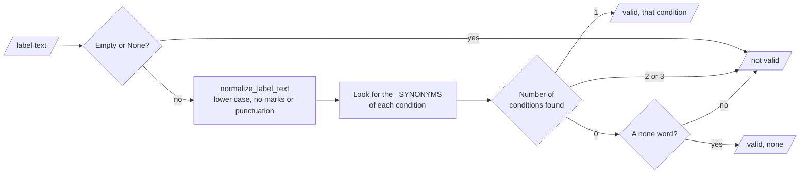
- The evaluation compares the screening with a keyword baseline and a majority baseline (see [12](#12-validation-results)).

---

## 7. The diet plan and follow-up questions

**Purpose.** Give a cited diet plan for one condition, with real food examples, and answer follow-up questions in a session.

| Input | Output |
|---|---|
| A condition (`diabetes`, `heart` or `thyroid`) | `DietPlan`: summary, nutrients, food examples, foods to avoid, sources, warnings |
| A session id and a question | `Answer`: status, text with markers, source list |

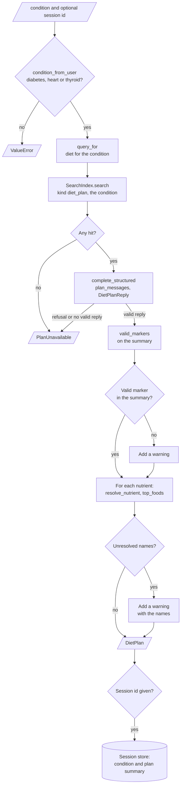

**Procedure (diet plan)**

1. Retrieve `diet_plan` hits for the condition.
2. Ask the chat model for the JSON reply with `nutrients_recommended`, `diet_plan_summary`, `foods_to_avoid` and `citations`.
3. Validate the reply. Normalize the lists: one string per item, no duplicates.
4. Keep the valid markers. If the summary has no valid marker, add a warning.
5. Resolve each nutrient. Get `NUTRIBUDDY_FOODS_PER_NUTRIENT` food examples for each resolved nutrient.
6. If the session id is given, save the condition and the plan summary in the session.

The diagram shows how the food store gives the food examples for one nutrient name from the chat model.

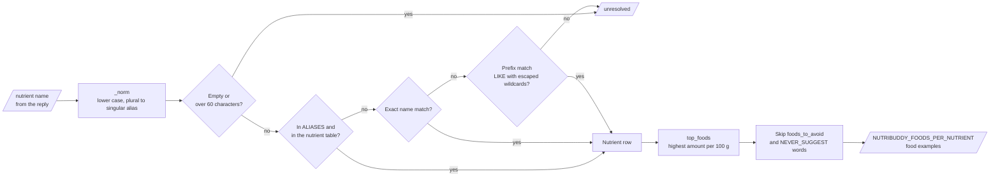

**Procedure (follow-up question)**

1. Clean the question. Return `urgent` for a red flag and `out_of_scope` for a question with no diet word.
2. Make the search query from the question, the session condition and the last user question.
3. Retrieve `diet_plan` hits for the session condition.
4. Ask the chat model for a plain-text answer with markers. Keep the valid markers.
5. If no valid marker is left, return `no_evidence` with "The sources do not answer this question."
6. Save the question and the answer as two turns.

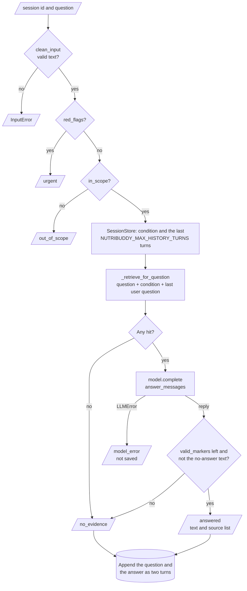

**Rules**

- The session store keeps the last 40 turns of a session. The prompt gets the last `NUTRIBUDDY_MAX_HISTORY_TURNS` turns.
- The session id is a random 24-character value from `secrets.token_urlsafe`.

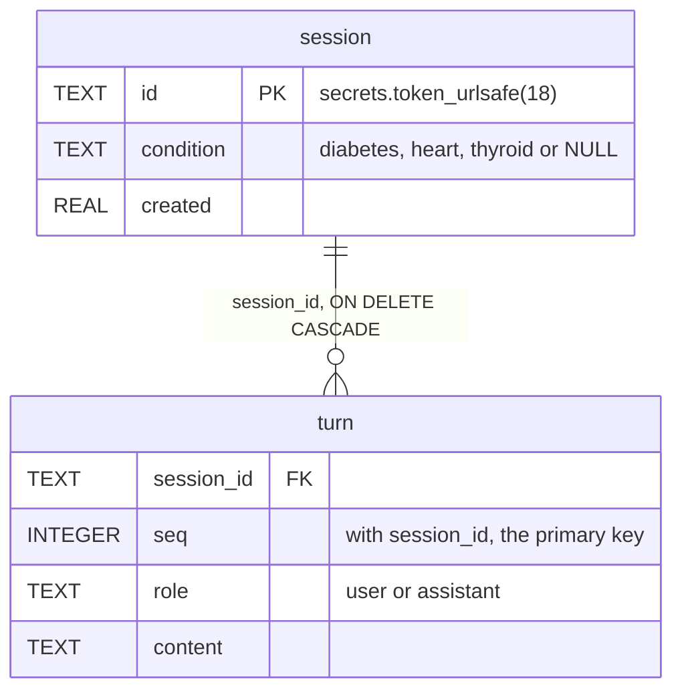

---

## 8. The safety model and the decision rules

The diagram shows where each safety rule acts on the path of one request.

```mermaid
flowchart LR
    U[/"User text"/] --> CI["clean_input<br/>NFKC, no control characters, length"]
    CI --> RF{"red_flags"}
    RF -- "found" --> URG{{"HUMAN<br/>urgent: emergency services or a clinician"}}
    RF -- "none" --> SC["in_scope<br/>diet word check, questions only"]
    SC --> EV["Evidence check<br/>in SearchIndex.search"]
    EV --> PR["Prompts: passages are data,<br/>text in triple angle brackets"]
    PR --> CS["complete_structured<br/>bounded retries"]
    CS --> VM["valid_markers<br/>1 to the number of passages"]
    VM --> SQL["resolve_nutrient<br/>bound parameters only"]
    SQL --> NS["NEVER_SUGGEST and<br/>foods_to_avoid filter"]
    NS --> OUT["to_html escape<br/>or textContent on the page"]
    OUT --> REV{{"HUMAN<br/>clinician or dietitian review"}}

    classDef human fill:#fff3cd,stroke:#b8901f,color:#3d2f00,font-weight:bold
    class URG,REV human
```

| Rule | Value | Code |
|---|---|---|
| Input length | 1 to `NUTRIBUDDY_MAX_INPUT_CHARS` characters (default 600), at least one letter | `safety.clean_input` |
| Allowed characters | All printable characters. Digits, commas and apostrophes are allowed | `safety.clean_input` |
| Red flags | chest pain, breathing difficulty, fainting, stroke signs, confusion, blood sugar of 300 or more or from 10 to 59, vomiting blood, self-harm | `safety.RED_FLAGS` |
| Scope | The question must contain a diet, food, nutrient or condition word | `safety.in_scope` |
| Evidence check | Shared token and cosine ≥ `NUTRIBUDDY_MIN_SCORE` (default 0.05) | `index.SearchIndex.search` |
| Retries | At most `NUTRIBUDDY_LLM_MAX_ATTEMPTS` (default 3). A refusal stops the retries | `schemas.complete_structured` |
| Markers | A marker must be between 1 and the number of passages | `planner.valid_markers` |
| Foods never suggested | bacon, chips, soft drink, cola, candy, fried, sausage | `fooddb.NEVER_SUGGEST` |

| Screening status | Meaning |
|---|---|
| `urgent` | The text has a red flag. The message tells the user to contact emergency services or a clinician |
| `possible_condition` | The sources connect the symptoms with one condition. This is not a diagnosis |
| `no_match` | No hit passed the evidence check, or the chat model said none or refused |
| `unparsed` | The reply was not valid after all retries, or it named more than one condition |

| Answer status | Meaning |
|---|---|
| `answered` | The answer has at least one valid marker |
| `no_evidence` | No hit passed the evidence check, or the answer has no valid marker |
| `out_of_scope` | The question is not about diet, food or nutrition |
| `urgent` | The question has a red flag |
| `model_error` | The chat model did not answer |

---

## 9. Data and file map

| Path | Committed? | Contents |
|---|---|---|
| `data/README.md` | Yes | Sources, licences, layout and download steps |
| `data/sources.json` | No (git ignores it) | The source registry |
| `data/disease/`, `data/diet_plan/` | No (git ignores it) | Source documents |
| `data/food_data/` | No (git ignores it) | FoodData Central CSV files |
| `data/eval/` | No (git ignores it) | `screening.jsonl` and `retrieval.jsonl` |
| `.nutribuddy/index/` | No (git ignores it) | The index |
| `.nutribuddy/foods.sqlite` | No (git ignores it) | The food store |
| `.nutribuddy/sessions.sqlite` | No (git ignores it) | The session store |
| `.nutribuddy/demo/` | No (git ignores it) | Synthetic data, index and stores of `nutribuddy demo` |
| `.env` | No (git ignores it) | Local credentials |

---

## 10. How to run nutribuddy

### 10.1 Prerequisites

| Need | For |
|---|---|
| Python 3.11+ | All components |
| Ollama or another OpenAI-compatible endpoint | Optional: a real chat model |
| FoodData Central CSV download | Optional: real food examples |

### 10.2 Installation

```bash
git clone https://github.com/KrishnaAnnavaram/nutribuddy.git
cd nutribuddy
python -m venv .venv
. .venv/bin/activate            # Windows: .venv\Scripts\activate
pip install -e ".[dev]"         # extras: pdf, embeddings, api, all
```

### 10.3 Run nutribuddy

```bash
# 1. Offline demo on synthetic data (no key, no network)
nutribuddy demo

# 2. Your own data (see data/README.md)
nutribuddy load-foods --fdc-dir data/food_data
nutribuddy index
nutribuddy screen "I am always thirsty and small cuts heal slowly"
nutribuddy plan heart
SID=$(nutribuddy session --condition heart)
nutribuddy ask "$SID" "Which fish give omega-3 fatty acids?"
nutribuddy eval --out reports/eval.json

# 3. A real chat model through Ollama
ollama pull llama3.1:8b
NUTRIBUDDY_LLM_PROVIDER=openai NUTRIBUDDY_LLM_BASE_URL=http://localhost:11434/v1 nutribuddy plan diabetes

# 4. The web page and the JSON API (extra: api)
pip install -e ".[api]"
nutribuddy serve --port 8000
```

`nutribuddy synth --out data/synthetic` writes the synthetic data only. Add `--json` to `screen`, `plan` and `ask` for JSON output.

The diagram shows the order of the commands and the files that connect them.

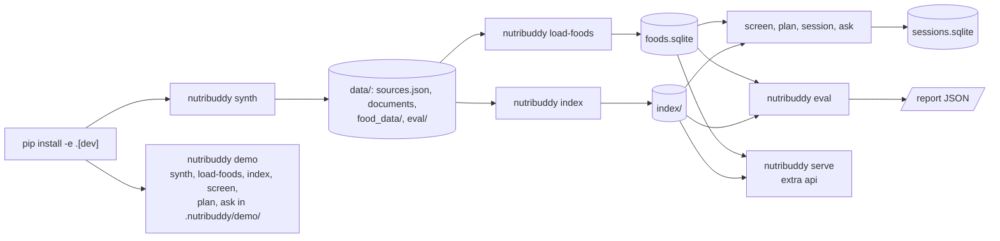

### 10.4 Environment variables

| Variable | Used by | Meaning |
|---|---|---|
| `NUTRIBUDDY_DATA_DIR` | Ingestion, evaluation | The data folder. Default `data` |
| `NUTRIBUDDY_WORK_DIR` | All | The folder for the index and the stores. Default `.nutribuddy` |
| `NUTRIBUDDY_EMBEDDER` | Index | `hashing` (default) or `sentence-transformers` |
| `NUTRIBUDDY_EMBED_MODEL` | Index | sentence-transformers model. Default `BAAI/bge-small-en-v1.5` |
| `NUTRIBUDDY_RERANKER` | Search | `coverage` (default), `cross-encoder` or `none` |
| `NUTRIBUDDY_LLM_PROVIDER` | Chat model | `offline` (default) or `openai` |
| `NUTRIBUDDY_LLM_BASE_URL` | Chat model | Default `http://localhost:11434/v1` (Ollama) |
| `NUTRIBUDDY_LLM_MODEL` | Chat model | Default `llama3.1:8b` |
| `NUTRIBUDDY_LLM_API_KEY` | Chat model | Bearer token. Empty for Ollama |
| `NUTRIBUDDY_LLM_TIMEOUT_S` | Chat model | HTTP timeout in seconds. Default 60 |
| `NUTRIBUDDY_LLM_MAX_ATTEMPTS` | Structured output | 1 to 5. Default 3 |
| `NUTRIBUDDY_CHUNK_WORDS` | Chunker | Words in each chunk. Default 180 |
| `NUTRIBUDDY_CHUNK_OVERLAP` | Chunker | Words of overlap. Default 40. Must be less than the chunk size |
| `NUTRIBUDDY_TOP_K` | Search | Passages in each prompt. Default 4 |
| `NUTRIBUDDY_MIN_SCORE` | Evidence check | Minimum cosine similarity. Default 0.05 |
| `NUTRIBUDDY_MAX_INPUT_CHARS` | Safety | Maximum input length. Default 600 |
| `NUTRIBUDDY_MAX_HISTORY_TURNS` | Follow-up answers | Turns in the prompt. Default 6 |
| `NUTRIBUDDY_FOODS_PER_NUTRIENT` | Planner | Food examples for each nutrient. Default 3 |

Credentials are only in a local `.env` file. Git ignores this file. Do not print or commit credentials. nutribuddy reads environment variables only. It does not read the `.env` file: load it in your shell before you run a command.

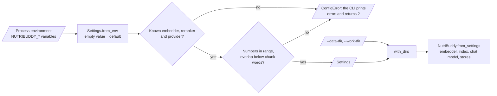

---

## 11. How to extend nutribuddy

| You want to… | Do this | Code change? |
|---|---|---|
| Add a source | Put the file under `data/<kind>/<condition>/`, add an entry to `sources.json`, run `nutribuddy index` | No |
| Use a better embedder | `pip install -e ".[embeddings]"`, set `NUTRIBUDDY_EMBEDDER=sentence-transformers`, run `nutribuddy index` | No |
| Use a cross-encoder reranker | Install the `embeddings` extra and set `NUTRIBUDDY_RERANKER=cross-encoder` | No |
| Use a hosted chat model | Set `NUTRIBUDDY_LLM_PROVIDER=openai`, the base URL, the model and the key | No |
| Map a new nutrient word | Add it to `fooddb.ALIASES` | Small |
| Add a red flag | Add a pattern to `safety.RED_FLAGS` and a test | Small |
| Add a condition | Add it to `Condition` and `_SYNONYMS`, add sources and evaluation items | Yes |
| Use PostgreSQL for the food store | Write a store with the same three functions as `fooddb` | Yes |

---

## 12. Validation results

`nutribuddy eval` runs `evaluation.run_all`. The diagram shows its parts.

```mermaid
flowchart LR
    ED[/"data/eval/"/] --> R{"retrieval.jsonl<br/>exists?"}
    R -- "yes" --> RET["evaluate_retrieval<br/>recall@k, MRR"]
    ED --> S{"screening.jsonl<br/>exists?"}
    S -- "yes" --> SCR["evaluate_screening<br/>nutribuddy, keyword baseline,<br/>majority baseline"]
    SCR --> CM["classification_metrics<br/>accuracy, Wilson 95 % CI, macro-F1"]
    PL["evaluate_plans<br/>each condition"] --> REP
    SAF["evaluate_safety<br/>red flags, benign, injection,<br/>food store unchanged"] --> REP
    RET --> REP[/"report JSON<br/>--out file"/]
    CM --> REP
```

| Validation | Result | Command |
|---|---|---|
| Unit tests | **72 passed, 1 skipped** in CI, because the `api` extra is not installed. With the `api` extra: 73 passed | `pytest -q` |
| Retrieval, 18 synthetic questions | recall@4 = **1.000**, MRR = **1.000** | `nutribuddy eval` after `nutribuddy demo` |
| Screening, 60 synthetic items, offline model | accuracy **0.783** (95% CI 0.664 to 0.869), macro-F1 **0.776** | same |
| Screening, keyword baseline | accuracy **0.850** (95% CI 0.739 to 0.919), macro-F1 **0.853** | same |
| Screening, majority baseline | accuracy **0.250**, macro-F1 **0.100** | same |
| Diet plans, 3 conditions | 3 of 3 plans cited. All food examples come from the food store. No food to avoid is suggested | same |
| Safety | red flags found in 6 of 6 urgent prompts, 0 of 4 benign prompts flagged, food store unchanged after injection prompts | same |

All numbers come from synthetic data. They show that the components work together. They do not show the quality on real sources or real users. The offline model makes most screening errors on the `none` class: it labels 7 of 15 unrelated symptom texts with a condition. The keyword baseline is better on this set because the same author wrote the lexicon and the synthetic items. The prototype reported a screening accuracy of 90%. That is a prototype result, not reproduced here, and the prototype had no labelled test set.

---

## 13. Known problems

Read these problems before you use nutribuddy in production.

| # | Area | Problem | Impact and action |
|---|---|---|---|
| 1 | Data | The repository has no real sources and no real food table. CI uses synthetic data only | Results on real data are not measured. Register real sources and run `nutribuddy eval` |
| 2 | Screening | The offline model gives a condition for many unrelated symptoms (8 of 15 correct `none` labels) | Use a real chat model and a clinician-labelled evaluation set |
| 3 | Evaluation | The synthetic evaluation sets are small (60 and 18 items) and the same author wrote them and the documents | Treat the numbers as a check of the code, not of quality |
| 4 | Medical scope | nutribuddy does not know medicines, allergies, kidney function or pregnancy | A clinician must review every plan |
| 5 | Food examples | The food examples rank by the amount of one nutrient. They do not check sodium, sugar or energy | The `NEVER_SUGGEST` list removes some foods. A dietitian must review the list |
| 6 | Red flags | The red-flag check uses fixed English patterns | Other phrasings and other languages are not found |
| 7 | Prompt injection | Passages and user text are marked as data, but a real chat model can still follow an injected instruction | Output is always plain text, SQL has bound parameters and markers are checked |
| 8 | Bias | Public sources mostly describe adult populations from a small number of countries | Food and symptom guidance can be wrong for other groups |
| 9 | Food store | Only SQLite is supported | Write a PostgreSQL store for a multi-user deployment |

---

## 14. Key points

1. **Each claim has a valid source.** The planner removes markers that point to no passage and lists the source of each valid marker.
2. **The chat model never touches SQL.** Nutrient names resolve against the `nutrient` table with bound parameters.
3. **Screening is not a diagnosis.** Red flags go to urgent care first, and the message tells the user to see a clinician.
4. **The offline flow is complete.** The demo, the tests and the evaluation need no key, no download and no network.
5. **The numbers are honest.** The evaluation compares the offline model with two baselines and reports the intervals.

---

## 15. Glossary

| Term | Meaning |
|---|---|
| **Condition** | `diabetes`, `heart` or `thyroid` |
| **Source** | One registered document with its id, title, URL, licence, condition and kind |
| **Registry** | The file `sources.json` |
| **Kind** | `disease` (symptoms) or `diet_plan` (nutrition guidance) |
| **Chunk** | One unit of text that nutribuddy stores and retrieves |
| **Overlap** | The words at the end of a chunk that the next chunk starts with |
| **Index** | The folder with the chunks, the vectors and the manifest |
| **Fingerprint** | The SHA-256 value that ties the index files to the embedder |
| **Embedder** | The provider that changes a text into a vector |
| **Hit** | A chunk that the search returns, with its scores |
| **Passage** | A hit with a number `[n]` in a prompt |
| **Marker** | A passage number in square brackets in model text |
| **Citation** | The title, page, section and URL of the source of a marker |
| **Evidence check** | The rule that a candidate shares a token with the query and passes the minimum cosine similarity |
| **Reranker** | The second search stage that orders the fused candidates again |
| **Chat model** | The provider that writes the JSON reply or the answer |
| **Offline model** | The deterministic chat model that needs no key and no network |
| **Screening** | The step that tells which condition the sources connect to the symptoms |
| **Red flag** | A symptom phrase that needs urgent care |
| **Diet plan** | The cited summary, nutrients, food examples and foods to avoid for one condition |
| **Food store** | The SQLite database with the FoodData Central tables |
| **Food example** | One food with its amount of one nutrient per 100 g |
| **Session** | One conversation, kept on the server under a random id |
| **Refusal** | The reply `{"error": ...}` when the passages have no diet advice |

---

## 16. License

[MIT](LICENSE) © 2026 Krishna Annavaram
